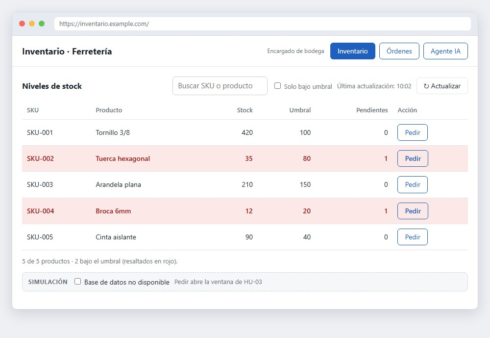

# HU-01 Consultar niveles de stock

**Como** encargado de bodega,
**quiero** ver el stock, el umbral mínimo y las órdenes pendientes de cada producto,
**para** saber de un vistazo qué productos están en riesgo de quiebre.

### Criterios de aceptación

**Escenario 1: Listado con alertas**
- **Given** que existen productos registrados
- **When** abro la pantalla de inventario
- **Then** veo SKU, nombre, stock, umbral y órdenes pendientes de cada producto
- **And** los productos con stock por debajo del umbral aparecen resaltados en rojo

**Escenario 2: Base de datos no disponible**
- **Given** que la base de datos no responde
- **When** abro la pantalla de inventario
- **Then** veo el mensaje "No se pudo cargar el inventario, reintente" sin datos parciales

### Fuera de alcance
- Edición de productos (alta/baja/modificación).

**Puntos:** 2 · `tipo: feature` `prioridad: alta` `área: frontend` `puntos: 2`

### Mockup

Mockup interactivo (abrir en el navegador): [HU-01.html](HU-01.html)
