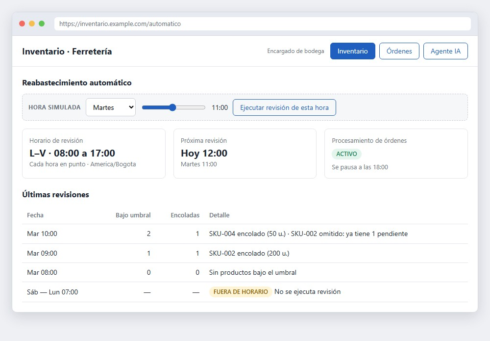

# HU-02 Reabastecer automáticamente en horario hábil

**Como** encargado de bodega,
**quiero** que el sistema revise el stock cada hora de lunes a viernes entre 8:00 y 18:00 y pida reabastecimiento solo cuando haga falta,
**para** no tener que vigilar manualmente los umbrales.

### Criterios de aceptación

**Escenario 1: Producto bajo el umbral**
- **Given** un producto con stock 35, umbral 80 y 0 órdenes pendientes
- **When** se ejecuta la revisión horaria en día hábil
- **Then** se encola una solicitud de reabastecimiento por la cantidad de reorden
- **And** el contador de órdenes pendientes del producto pasa a 1

**Escenario 2: Ya existe una solicitud en curso**
- **Given** un producto bajo el umbral con 1 orden pendiente
- **When** se ejecuta la revisión
- **Then** no se encola una solicitud duplicada

**Escenario 3: Fin de semana o fuera de horario**
- **Given** que es sábado o son las 19:00 de un día hábil
- **When** llega la hora en punto
- **Then** la revisión no se ejecuta

**Puntos:** 3 · `tipo: feature` `prioridad: alta` `área: backend` `puntos: 3`

### Mockup

Mockup interactivo (abrir en el navegador): [HU-02.html](HU-02.html)
