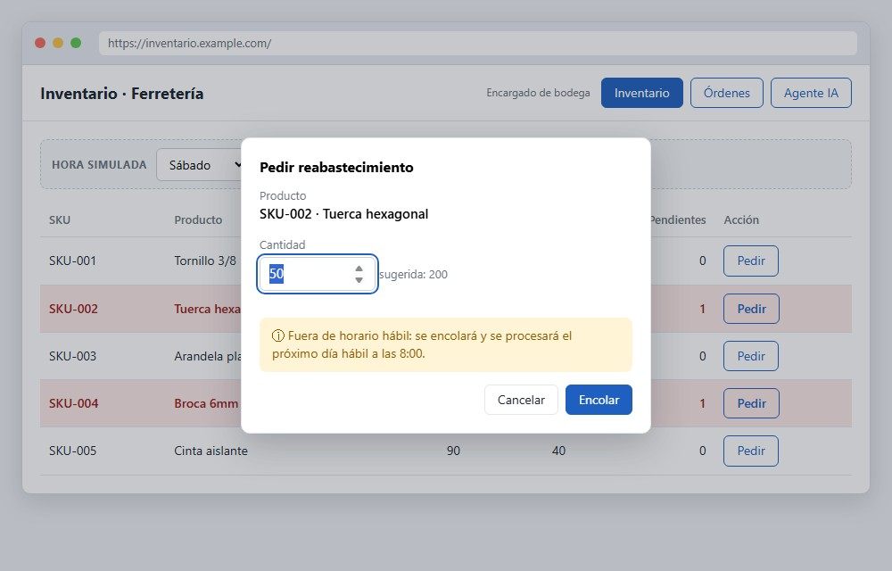

# HU-03 Solicitar reabastecimiento manual en cualquier horario

**Como** encargado de bodega,
**quiero** pedir reabastecimiento de un producto a cualquier hora,
**para** registrar la necesidad aunque las compras se procesen en horario hábil.

### Criterios de aceptación

**Escenario 1: Solicitud en horario hábil**
- **Given** que es martes a las 10:00
- **When** pido 50 unidades de SKU-002
- **Then** veo "Solicitud encolada" y en minutos aparece la orden de compra

**Escenario 2: Solicitud fuera de horario**
- **Given** que es sábado
- **When** pido 50 unidades de SKU-002
- **Then** veo "Solicitud encolada; se procesará el próximo día hábil a las 8:00"
- **And** la solicitud queda en estado EN COLA sin generar orden de compra

**Escenario 3: Cantidad inválida**
- **When** pido 0 o más de 10 000 unidades
- **Then** veo "Cantidad entre 1 y 10000" y no se encola nada

**Puntos:** 3 · `tipo: feature` `prioridad: media` `área: frontend` `puntos: 3`

### Mockup

Mockup interactivo (abrir en el navegador): [HU-03.html](HU-03.html)
