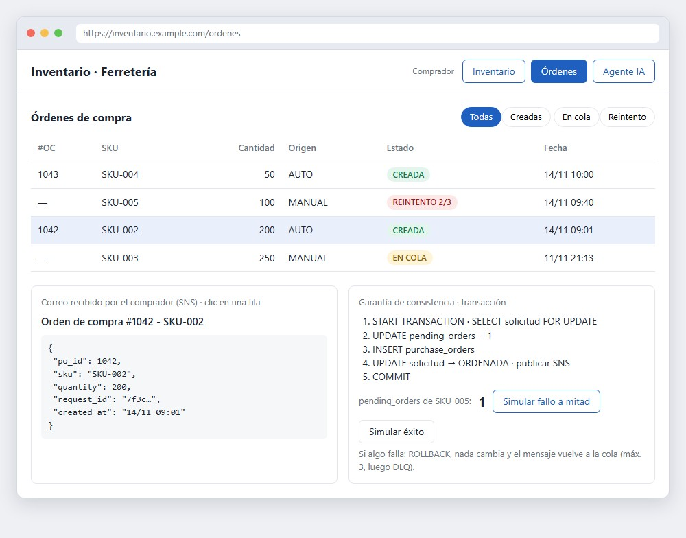

# HU-04 Generar orden de compra de forma atómica y notificar

**Como** comprador,
**quiero** recibir una notificación cada vez que se genera una orden de compra,
**para** gestionar el pedido con el proveedor sin revisar el sistema.

### Criterios de aceptación

**Escenario 1: Orden creada**
- **Given** una solicitud EN COLA para SKU-002 por 200 unidades
- **When** el sistema la procesa
- **Then** se crea la orden de compra, la solicitud pasa a ORDENADA y el contador de pendientes baja en 1
- **And** recibo un correo con SKU, cantidad y número de orden

**Escenario 2: Fallo a mitad del proceso**
- **Given** que el proceso falla después de descontar el contador y antes de crear la orden
- **When** se revisa la base de datos
- **Then** el contador de pendientes y las órdenes quedan exactamente como antes del intento
- **And** la solicitud vuelve a la cola para reintento (máx. 3, luego a la cola de errores)

**Escenario 3: Un mensaje defectuoso en un lote**
- **Given** un lote de 10 solicitudes donde 1 falla
- **When** se procesa el lote
- **Then** las 9 correctas generan su orden y solo la fallida vuelve a la cola

**Puntos:** 5 · `tipo: feature` `prioridad: alta` `área: backend` `puntos: 5`

### Mockup

Mockup interactivo (abrir en el navegador): [HU-04.html](HU-04.html)
