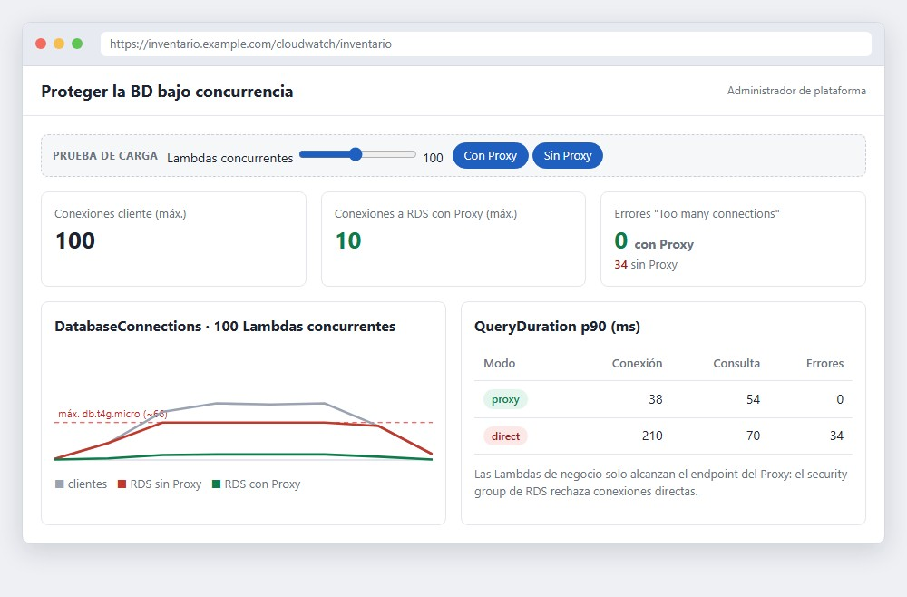

# HU-05 Proteger la base de datos bajo concurrencia

**Como** administrador de plataforma,
**quiero** que todas las Lambdas accedan a la base de datos solo a través de RDS Proxy,
**para** que los picos de concurrencia no agoten las conexiones de RDS.

### Criterios de aceptación

**Escenario 1: Carga concurrente con Proxy**
- **Given** 100 invocaciones concurrentes de la Lambda de prueba vía Proxy
- **When** reviso CloudWatch
- **Then** `DatabaseConnections` de RDS se mantiene muy por debajo de las conexiones cliente
- **And** no hay errores "Too many connections"

**Escenario 2: Conexión directa bloqueada**
- **Given** una Lambda de negocio
- **When** intenta conectarse al endpoint de la instancia RDS
- **Then** la conexión es rechazada por el security group

**Puntos:** 5 · `tipo: mejora` `prioridad: alta` `área: infra` `puntos: 5`

### Mockup

Mockup interactivo (abrir en el navegador): [HU-05.html](HU-05.html)
