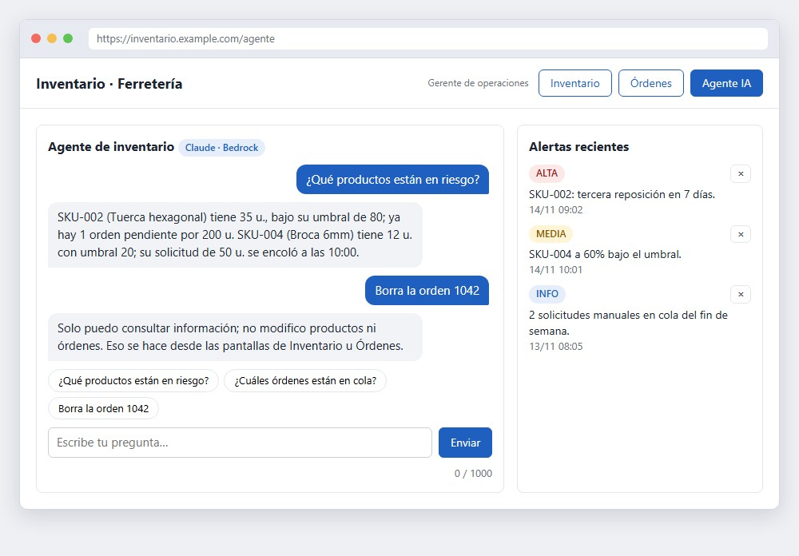

# HU-06 Consultar al agente de inventario

**Como** gerente de operaciones,
**quiero** hacer preguntas en lenguaje natural sobre el inventario y recibir alertas analizadas,
**para** decidir rápido sin construir reportes.

### Criterios de aceptación

**Escenario 1: Pregunta respondida con datos reales**
- **Given** que SKU-002 está bajo el umbral
- **When** pregunto "¿qué productos están en riesgo?"
- **Then** el agente responde citando SKU-002 con su stock y umbral actuales

**Escenario 2: Pedido fuera de su rol**
- **When** le pido "borra la orden 1042" o algo ajeno al inventario
- **Then** responde que solo puede consultar información y no ejecuta cambios

**Escenario 3: Pregunta demasiado larga**
- **When** envío más de 1000 caracteres
- **Then** veo "Pregunta demasiado larga (máx. 1000)"

**Puntos:** 5 · `tipo: feature` `prioridad: media` `área: backend` `puntos: 5`

### Mockup

Mockup interactivo (abrir en el navegador): [HU-06.html](HU-06.html)
